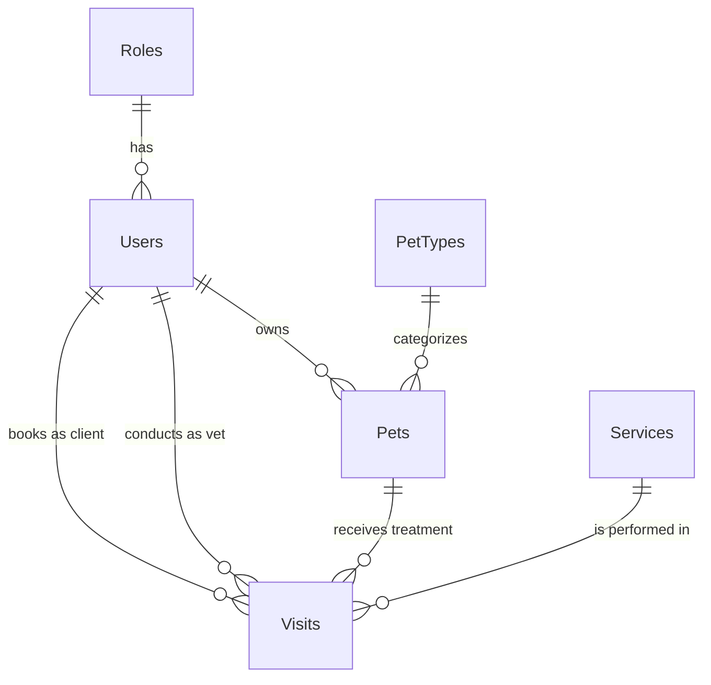
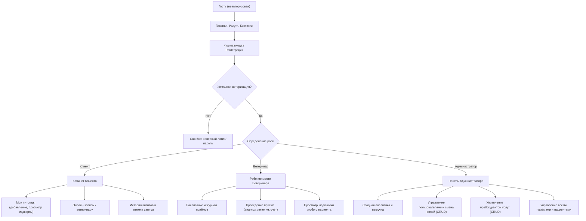

# ОТЧЁТ ПО ИНДИВИДУАЛЬНОЙ ПРАКТИЧЕСКОЙ РАБОТЕ

**Тема:** Разработка информационной системы с регистрацией пользователей и разграничением прав доступа  
**Вариант:** № 16  
**Студент:** Макаренко Данил Александрович  
**Учебная группа:** 413 группа  
**Учебное заведение:** ГОУ «Тираспольский техникум информатики и права» (ТТИиП)  
**Предметная область:** Ветеринарная клиника (г. Кишинёв, Республика Молдова)  
**Процесс автоматизации:** Учёт животных и посещений  
**Основные роли:** Администратор, ветеринар, клиент (+ гость)  

---

## 1. Титульный лист (Сведения о работе)
- **Учебное заведение:** ГОУ «Тираспольский техникум информатики и права» (ТТИиП)
- **Отделение:** Информационных технологий и программирования
- **Дисциплина:** Разработка веб-приложений и информационных систем
- **Тема работы:** «Разработка веб-информационной системы для автоматизации учёта животных и посещений в ветеринарной клинике»
- **Выполнил:** студент 413 группы Макаренко Данил Александрович (Вариант № 16)
- **Проверил:** Преподаватель Парван ...
- **Год выполнения:** 2026

---

## 2. Тема и номер варианта
- **Номер варианта:** 16
- **Предметная область:** Ветеринарная клиника «ВетЗабота» (г. Кишинёв, Молдова)
- **Объект автоматизации:** Процессы регистрации пациентов (животных), записи на приём к ветеринарным врачам, ведения электронных медицинских карт и протоколов осмотра, управления прейскурантом услуг и ролями пользователей.

---

## 3. Цель работы
Разработать современное веб-приложение для комплексной автоматизации процессов ветеринарной клиники с использованием аутентификации пользователей, регистрации новых клиентов и сотрудников, а также строгим разграничением прав доступа к функциям системы в зависимости от назначенной роли.

---

## 4. Описание предметной области
Ветеринарная клиника оказывает амбулаторные и стационарные лечебно-диагностические услуги домашним и экзотическим животным. В традиционном (неавтоматизированном) режиме работа клиники сопряжена с рядом проблем:
- Утрата бумажных медицинских карт или неразборчивость записей врачей;
- Ошибки при формировании расписания и записи владельцев на приём (двойная запись, очереди);
- Отсутствие единого прейскуранта и сложности с анализом финансовых показателей;
- Невозможность для клиента удалённо отслеживать историю вакцинаций и назначений для своего питомца.

Внедрение веб-информационной системы автоматизирует ключевые бизнес-процессы:
1. Ведение картотеки животных с учётом биологического вида, породы, пола, веса и индивидуальных особенностей здоровья (аллергии, хронические заболевания).
2. Электронная запись на приём к профильным специалистам (хирург, терапевт, диагност) с выбором услуги из каталога.
3. Формирование протоколов осмотра с фиксацией анамнеза, диагноза, схемы медикаментозного лечения и стоимости.
4. Централизованный контроль персонала, каталога услуг и выручки администратором клиники.

---

## 5. Постановка задачи
В рамках выполнения работы необходимо:
1. Спроектировать реляционную базу данных со связями «один-ко-многим» между пользователями, ролями, животными, услугами и посещениями.
2. Реализовать регистрацию новых пользователей с валидацией входных данных и выбором роли (Клиент или Ветеринар).
3. Реализовать авторизацию на основе защищённых сессионных cookie-файлов и безопасное хеширование паролей по стандарту PBKDF2 (SHA-256 с индивидуальной солью).
4. Настроить ролевую модель доступа (Role-Based Access Control, RBAC) с запретом несанкционированного доступа к закрытым разделам (страница 403 Forbidden).
5. Разработать CRUD-интерфейсы:
   - для клиентов: добавление, просмотр и редактирование данных своих животных, запись на приём, отмена приёма;
   - для ветеринаров: доступ к расписанию, проведение приёма, фиксация диагноза и назначений;
   - для администраторов: полный контроль всех пользователей, животных, приёмов и услуг.
6. Внедрить фильтрацию и поиск по множественным критериям (кличка, статус визита, диапазон дат, доктор, цена).
7. Обеспечить валидацию полей на стороне клиента и сервера, а также всплывающие уведомления об успехе или ошибке операций.
8. Подготовить инструкции для пользователей и администратора, план внедрения и программу обновлений.

---

## 6. Описание ролей пользователей

| Роль | Права и доступные функции |
| :--- | :--- |
| **Гость** (неавторизованный) | Просмотр главной страницы с описанием клиники, каталога услуг с ценами и фильтрацией, контактов и информации о врачах. Переход на страницы входа и регистрации. |
| **Клиент** (владелец животного) | Личный кабинет, управление карточками своих питомцев (добавление, редактирование, просмотр), онлайн-запись на приём, просмотр истории назначений и диагнозов, отмена запланированной записи, смена пароля. Не может просматривать чужих животных или посещения. |
| **Ветеринар** (врач клиники) | Просмотр реестра приёмов, назначенных к нему, фильтрация по датам и статусам, проведение осмотра (внесение анамнеза, диагноза, терапии, стоимости), просмотр электронных медкнижек пациентов. |
| **Администратор** (управляющий) | Полный доступ: сводный дашборд с аналитикой и выручкой клиники, управление учётными записями пользователей (CRUD, изменение роли, сброс пароля), управление прейскурантом услуг (CRUD), управление всеми приёмами и пациентами. |

---

## 7. Функциональные требования
1. **Регистрация:** ввод ФИО, логина (латиница/цифры), email, телефона, пароля (от 4 символов), подтверждения пароля и выбора роли. При выборе роли «Ветеринар» отображается поле «Специализация».
2. **Аутентификация:** вход по логину и паролю, опция «Запомнить меня», безопасный выход (Logout).
3. **Безопасность:** защита от CSRF-атак (`[ValidateAntiForgeryToken]`), запрет прямого ввода URL закрытых страниц (редирект на `/Account/Login` или `/Account/AccessDenied`).
4. **Учёт животных:** хранение клички, вида, породы, пола, даты рождения, веса, особенностей здоровья. Автоматический расчёт возраста на текущую дату.
5. **Запись на приём:** проверка даты (запрет записи в прошлое), выбор доступного животного, врача и услуги.
6. **Проведение приёма:** перевод статуса в «Завершён», обязательный ввод диагноза и назначений, формирование печатного протокола.
7. **Поиск и фильтрация:**
   - Услуги: поиск по названию/описанию, фильтрация по максимальной цене.
   - Питомцы: поиск по кличке/породе/владельцу, фильтрация по виду.
   - Приёмы: фильтрация по статусу («Запланирован», «В процессе», «Завершён», «Отменён»), датам «с» и «по», ветеринару.
   - Пользователи: поиск по ФИО, логину, email, телефону, фильтр по роли.
8. **Обратная связь:** вывод информационных баннеров `TempData["SuccessMessage"]` и `TempData["ErrorMessage"]`.

---

## 8. Структура базы данных

### 8.1. Таблица `Roles` (Роли пользователей)
| Поле | Тип данных | Ограничения | Назначение |
| :--- | :--- | :--- | :--- |
| `Id` | INTEGER | PRIMARY KEY, AUTOINCREMENT | Идентификатор роли |
| `Name` | TEXT | NOT NULL, UNIQUE, VARCHAR(50) | Название роли («Администратор», «Ветеринар», «Клиент») |

### 8.2. Таблица `Users` (Пользователи системы)
| Поле | Тип данных | Ограничения | Назначение |
| :--- | :--- | :--- | :--- |
| `Id` | INTEGER | PRIMARY KEY, AUTOINCREMENT | Идентификатор пользователя |
| `Login` | TEXT | NOT NULL, UNIQUE, VARCHAR(50) | Уникальный логин |
| `PasswordHash` | TEXT | NOT NULL | Хеш пароля (PBKDF2-SHA256) |
| `FullName` | TEXT | NOT NULL, VARCHAR(100) | ФИО пользователя |
| `Email` | TEXT | NOT NULL, VARCHAR(100) | Электронная почта |
| `Phone` | TEXT | NULL, VARCHAR(25) | Телефон |
| `RoleId` | INTEGER | NOT NULL, FK -> Roles(Id) | Внешний ключ на роль |
| `Specialization`| TEXT | NULL, VARCHAR(100) | Специализация (для ветеринаров) |
| `CreatedAt` | DATETIME| NOT NULL | Дата регистрации |

### 8.3. Таблица `PetTypes` (Виды животных)
| Поле | Тип данных | Ограничения | Назначение |
| :--- | :--- | :--- | :--- |
| `Id` | INTEGER | PRIMARY KEY, AUTOINCREMENT | Идентификатор вида |
| `Name` | TEXT | NOT NULL, VARCHAR(50) | Название («Собака», «Кошка», «Птица», «Грызун», «Экзотическое») |

### 8.4. Таблица `Pets` (Животные / Пациенты)
| Поле | Тип данных | Ограничения | Назначение |
| :--- | :--- | :--- | :--- |
| `Id` | INTEGER | PRIMARY KEY, AUTOINCREMENT | Идентификатор питомца |
| `Name` | TEXT | NOT NULL, VARCHAR(60) | Кличка животного |
| `PetTypeId` | INTEGER | NOT NULL, FK -> PetTypes(Id) | Внешний ключ на вид животного |
| `Breed` | TEXT | NULL, VARCHAR(80) | Порода |
| `BirthDate` | DATE | NULL | Дата рождения |
| `Gender` | TEXT | NOT NULL, VARCHAR(10) | Пол («Самец», «Самка», «Не указан») |
| `Weight` | REAL | NULL | Вес в килограммах |
| `OwnerId` | INTEGER | NOT NULL, FK -> Users(Id) | Внешний ключ на владельца (клиента) |
| `MedicalNotes` | TEXT | NULL | Особенности здоровья / аллергии |
| `CreatedAt` | DATETIME| NOT NULL | Дата внесения в базу |

### 8.5. Таблица `Services` (Услуги клиники)
| Поле | Тип данных | Ограничения | Назначение |
| :--- | :--- | :--- | :--- |
| `Id` | INTEGER | PRIMARY KEY, AUTOINCREMENT | Идентификатор услуги |
| `Name` | TEXT | NOT NULL, VARCHAR(120) | Название процедуры |
| `Description` | TEXT | NOT NULL | Подробное описание процедуры |
| `Price` | NUMERIC | NOT NULL, CHECK (Price >= 0) | Стоимость в рублях |
| `DurationMinutes`| INTEGER | NOT NULL, CHECK (5..600) | Продолжительность в минутах |
| `IsActive` | BOOLEAN | NOT NULL, DEFAULT 1 | Доступность для онлайн-записи |

### 8.6. Таблица `Visits` (Посещения / Записи на приём)
| Поле | Тип данных | Ограничения | Назначение |
| :--- | :--- | :--- | :--- |
| `Id` | INTEGER | PRIMARY KEY, AUTOINCREMENT | Номер протокола / записи |
| `VisitDate` | DATETIME| NOT NULL | Дата и время проведения приёма |
| `PetId` | INTEGER | NOT NULL, FK -> Pets(Id) | Внешний ключ на животное |
| `ClientId` | INTEGER | NOT NULL, FK -> Users(Id) | Внешний ключ на клиента-владельца |
| `VeterinarianId`| INTEGER | NOT NULL, FK -> Users(Id) | Внешний ключ на врача-ветеринара |
| `ServiceId` | INTEGER | NOT NULL, FK -> Services(Id)| Внешний ключ на услугу |
| `Status` | TEXT | NOT NULL, VARCHAR(30) | Статус («Запланирован», «В процессе», «Завершён», «Отменён») |
| `Symptoms` | TEXT | NULL | Жалобы при обращении (анамнез) |
| `Diagnosis` | TEXT | NULL | Клинический диагноз врача |
| `Treatment` | TEXT | NULL | Назначенное лечение и медикаменты |
| `DoctorNotes` | TEXT | NULL | Примечания врача и рекомендации |
| `TotalCost` | NUMERIC | NOT NULL | Итоговая стоимость приёма |
| `CreatedAt` | DATETIME| NOT NULL | Дата оформления записи |

---

## 9. Схема взаимодействия пользователей с системой

---

## 10. Описание основных страниц сайта
1. **Главная страница (`/Home/Index`):** приветственный баннер, счётчики клиники, каталог популярных направлений, карточки врачей, блок преимуществ, вызов формы быстрой записи.
2. **Каталог услуг (`/Home/Services`):** фильтр по названию и стоимости, карточки процедур с указанием времени приёма и кнопкой перехода к записи.
3. **Контакты (`/Home/Contacts`):** адрес клиники, телефоны скорой помощи и регистратуры, график работы, схема проезда.
4. **Страница входа (`/Account/Login`):** форма авторизации с валидацией, флажком «Запомнить меня» и встроенным блоком кнопок «Быстрый вход для проверки» (Администратор, Ветеринар, Клиент).
5. **Страница регистрации (`/Account/Register`):** анкета регистрации с динамическим раскрытием поля специализации при выборе роли «Ветеринар».
6. **Личный кабинет (`/Account/Profile`):** редактирование контактных данных, отображение роли и безопасная смена пароля.
7. **Страница ошибки доступа (`/Account/AccessDenied`):** информационное сообщение о недостатке прав доступа с кодом 403.
8. **Реестр питомцев (`/Pets/Index`):** карточки животных, поиск по кличке/породе, фильтр по виду, индикатор возраста, переход к медкарте.
9. **Электронная медкарта (`/Pets/Details`):** паспорт животного и хронологическая лента всех осмотров с диагнозами и назначениями.
10. **Добавление/редактирование питомца (`/Pets/Create`, `/Pets/Edit`):** форма ввода данных с клиентской валидацией.
11. **Журнал приёмов (`/Visits/Index`):** таблица записей с цветовыми бэйджиками статусов, многокритериальной фильтрацией по датам, статусам и докторам.
12. **Протокол осмотра (`/Visits/Details`):** официальный медицинский документ с реквизитами клиники, печатью, подписью врача и кнопкой прямой печати на принтер.
13. **Проведение приёма (`/Visits/Conduct`):** форма врача для перевода статуса в «Завершён», фиксации анамнеза, диагноза, медикаментозной терапии и расчёта чека.
14. **Панель администратора (`/Admin/Index`):** сводная статистика пользователей, пациентов, визитов и выручки в рублях.
15. **Управление пользователями (`/Admin/Users`, `/Admin/UserEdit`):** поиск, фильтрация по ролям, смена роли пользователя, сброс пароля, удаление.
16. **Управление услугами (`/Admin/Services`, `/Admin/ServiceCreate`, `/Admin/ServiceEdit`):** добавление новых услуг, настройка цен и времени, деактивация.

---

## 11. Скриншоты разработанного приложения
*(Ниже приведены описания ключевых экранов для вставки скриншотов в чистовой печатный вариант)*
- **Скриншот 1:** Главная страница сайта клиники «ВетЗабота» со счётчиками и каталогом услуг.
- **Скриншот 2:** Форма авторизации с кнопками быстрого заполнения для демонстрации ролей.
- **Скриншот 3:** Личный кабинет клиента со списком питомцев и расчётом возраста.
- **Скриншот 4:** Электронная медицинская карта питомца с историей приёмов и назначенного лечения.
- **Скриншот 5:** Форма онлайн-записи на приём к ветеринару с выбором услуги и даты.
- **Скриншот 6:** Рабочее место ветеринара: форма проведения осмотра и внесения диагноза.
- **Скриншот 7:** Распечатываемый протокол ветеринарного осмотра пациента.
- **Скриншот 8:** Панель управления администратора со сводной аналитикой выручки и пользователей.
- **Скриншот 9:** Административное управление пользователями и сменой их системных ролей.
- **Скриншот 10:** Страница ограничения несанкционированного доступа (403 Access Denied).

---

## 12. Результаты тестирования

| № | Тест-кейс | Входные данные | Ожидаемый результат | Фактический результат | Статус |
| :- | :--- | :--- | :--- | :--- | :--- |
| 1 | Регистрация нового клиента | ФИО: Тестов Т.Т., логин: `test_user`, пароль: `test123`, роль: Клиент | Пользователь создан в БД, редирект на Login с сообщением об успехе | Аккаунт создан, отображён алерт об успехе | **Пройден** |
| 2 | Регистрация с существующим логином | Логин: `admin` | Ошибка валидации «Пользователь с таким логином уже существует» | Отображено сообщение об ошибке, форма не отправлена | **Пройден** |
| 3 | Авторизация с неверным паролем | Логин: `admin`, пароль: `wrongpass` | Ошибка «Неверный логин или пароль» | Ошибка отображена | **Пройден** |
| 4 | Авторизация администратора | Логин: `admin`, пароль: `admin123` | Вход выполнен, редирект на `/Admin`, отображено админ-меню | Успешный вход в панель администратора | **Пройден** |
| 5 | Попытка клиента открыть `/Admin` | Авторизован как `client_danil`, переход по URL `/Admin` | Перенаправление на страницу 403 `/Account/AccessDenied` | Доступ заблокирован, открыта страница 403 | **Пройден** |
| 6 | Добавление питомца клиентом | Кличка: «Рекс», вид: Собака, порода: Овчарка, дата рождения: 01.05.2023 | Питомец сохранён в БД с `OwnerId` текущего пользователя | Питомец отображён в списке питомцев клиента | **Пройден** |
| 7 | Запись на приём | Выбор питомца «Рекс», врач «Иванов», дата: завтра 12:00 | Создан визит со статусом «Запланирован», подсчитана стоимость | Визит создан и отображён в расписании врача | **Пройден** |
| 8 | Проведение приёма ветеринаром | Врач вводит диагноз «Гастрит», назначения «Диета Royal Canin», статус «Завершён» | Визит обновлён, статус стал зелёным, данные видны в медкарте | Протокол сформирован, выручка клиники пересчитана | **Пройден** |
| 9 | Фильтрация услуг по цене | Максимальная цена: 2000 руб. | Отображаются только услуги со стоимостью <= 2000 руб. | Отфильтровано корректно | **Пройден** |
| 10| Удаление пользователя администратором | Нажатие кнопки «Удалить» для тестового пользователя | Пользователь удалён из базы, список обновлён | Пользователь удалён, выведено подтверждение | **Пройден** |

---

## 13. План внедрения, инструкции и обновления

### 13.1. План внедрения сайта в ветеринарную клинику
1. **Этап 1: Инфраструктурная подготовка (1–3 день)**
   - Развёртывание веб-сервера (Windows Server с IIS / Linux Ubuntu с Nginx и Kestrel).
   - Установка среды исполнения .NET 9 Runtime.
   - Настройка HTTPS-сертификата (SSL/TLS) для защиты передаваемых персональных данных клиентов.
2. **Этап 2: Первоначальное наполнение базы данных (4–5 день)**
   - Внесение актуального штата ветеринарных врачей и администраторов клиники.
   - Актуализация прейскуранта услуг с действующими расценками.
   - Импорт архивной базы пациентов (при наличии).
3. **Этап 3: Обучение персонала (6–7 день)**
   - Проведение инструктажа для регистраторов клиники по работе с журналом записей.
   - Обучение ветеринарных врачей заполнению электронных протоколов и медкнижек.
4. **Этап 4: Опытная эксплуатация и запуск (8–14 день)**
   - Запуск сайта в открытый доступ, информирование постоянных клиентов о возможности онлайн-записи.
   - Сбор обратной связи, мониторинг стабильности системы.

### 13.2. Краткая инструкция пользователя (Клиента)
1. Откройте главную страницу сайта. Если у вас нет аккаунта, нажмите **«Регистрация»** и заполните анкету (ФИО, логин, email, телефон, пароль).
2. Выполните вход в систему через страницу **«Войти»**.
3. Перейдите в раздел **«Мои питомцы»** и добавьте своих животных (кнопка «Добавить питомца»).
4. Для записи на приём нажмите **«Записаться на приём»**, выберите своего питомца, врача, нужную услугу, удобное время и опишите жалобы.
5. В разделе **«Мои приёмы»** вы всегда можете посмотреть статус визита, ознакомиться с протоколом осмотра и рекомендациями врача после завершения приёма или отменить запись при необходимости.

### 13.3. Краткая инструкция ветеринарного врача
1. Войдите в систему под своей рабочей учётной записью (роль «Ветеринар»).
2. Перейдите в раздел **«Журнал приёмов»** — здесь отображаются все пациенты, записанные к вам.
3. Используйте фильтры по дате для просмотра приёмов на сегодня.
4. При начале приёма нажмите на значок пульсометра **«Провести приём»**.
5. Ознакомьтесь с анамнезом, внесите точный диагноз, назначенные медикаменты и дозировки, укажите итоговую стоимость и переведите статус в **«Завершён»**.
6. Нажмите **«Сохранить результаты приёма»** — данные мгновенно появятся в электронной медкарте животного и станут доступны владельцу.

### 13.4. Краткая инструкция администратора
1. Войдите в систему с логином `admin`.
2. В верхнем меню откройте раздел **«Администратор»**:
   - **Панель управления:** просмотр ключевых показателей клиники, количества пациентов и суммарной выручки.
   - **Пользователи и роли:** поиск пользователей, редактирование контактных данных, повышение клиентов до ветеринаров или назначение администраторов, сброс паролей.
   - **Прейскурант услуг:** добавление новых услуг, изменение цен и времени процедур, отключение неактуальных услуг.
   - **Все приёмы:** полный контроль над записями всех врачей, отмена или удаление некорректных записей.

### 13.5. Перечень возможных обновлений системы
1. **SMS- и Email-уведомления:** автоматическая отправка напоминаний клиентам за 24 часа и за 2 часа до начала запланированного визита.
2. **Интеграция с онлайн-оплатой:** возможность предоплаты услуг через СБП или банковские карты при онлайн-записи.
3. **Модуль складского учёта медикаментов:** автоматическое списание лекарственных средств и расходных материалов (шприцы, вакцины) при проведении приёма.
4. **Загрузка файлов и снимков в медкарту:** прикрепление файлов рентгеновских снимков (DICOM/JPG), УЗИ-сканов и PDF-бланков сторонних лабораторий прямо к протоколу визита.
5. **Телемедицина / Онлайн-консультации:** встроенный чат или видеосвязь между клиентом и дежурным врачом для повторных консультаций.

---

## 14. Вывод
В ходе выполнения индивидуальной практической работы разработана полноценная веб-информационная система «ВетЗабота» для комплексной автоматизации ветеринарной клиники (Вариант 16, Макаренко Данил).

В проекте полностью реализованы все требования:
- Создано веб-приложение на базе современного фреймворка ASP.NET Core MVC (.NET 9) с реляционной базой данных SQLite и Entity Framework Core;
- Реализованы механизмы регистрации, защищённой аутентификации на основе cookies и безопасного хеширования паролей (PBKDF2);
- Внедрено строгое разграничение прав доступа на базе ролей (Администратор, Ветеринар, Клиент, Гость) с защитой от несанкционированного доступа;
- Реализован полный цикл CRUD-операций для всех ключевых сущностей предметной области (животные, приёмы, медицинские протоколы, услуги, пользователи);
- Реализованы развитые механизмы поиска и фильтрации данных;
- Выполнено комплексное тестирование всех сценариев взаимодействия;
- Составлена исчерпывающая эксплуатационная документация и план внедрения.
